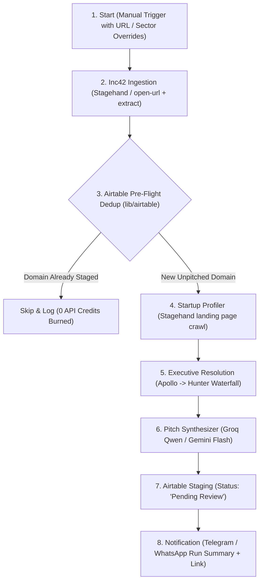

# Funded Startup Lead Generation & Outreach Pipeline (Concept Brief)

* **Document Version:** 1.0.0
* **Date:** 2026-11-10
* **Author:** Anurag1428
* **Synthesizer:** EGM Multi-Lens Swarm (7 Lenses: `egm-design`, `egm-codebase-details`, `egm-zoom-out`, `egm-comprehension`, `egm-implementation-readiness`, `egm-structural`, `egm-inventive-catalyst`)
* **Status:** Aligned / Design-Ready

---

## 1. Executive Summary & Problem Statement

Engineers, AI consultants, and specialized developers seek high-leverage opportunities at high-growth tech companies. Startups that have just closed funding rounds (tracked weekly in India by Inc42) represent peak buying intent: they are capitalized, under pressure to scale engineering/AI infrastructure rapidly, and actively hiring senior technical talent.

However, manual discovery, executive email verification, product research, and personalized pitch drafting take 30–45 minutes per company. Full automation with zero oversight leads to spammy, hallucinated cold emails that burn sender domain reputation.

This feature introduces a **manually triggered Navix workflow** that discovers funded startups from Inc42, profiles their product and technical stack, resolves a single primary technical executive (CTO or CEO) via an Apollo/Hunter waterfall, synthesizes a tailored AI/software engineering pitch, and stages drafts into Airtable for 1-click human review before dispatch.

---

## 2. In-Scope Goals vs. Out-of-Scope Non-Goals

### In-Scope Goals
* **Automated Funding Detection**: Extract startup names, website URLs, funding amounts, rounds, and investor lists from Inc42 funding articles using Stagehand browser extraction.
* **Product & Tech Profiling**: Analyze company landing pages and careers copy to extract core technical domains, tech stack hints, and product value propositions.
* **Waterfall Executive Resolution**: Resolve one primary technical decision-maker per company (CTO/VP Eng for growth; CEO/Co-Founder for early-stage) with verified corporate email using Apollo API with Hunter.io fallback.
* **Credit-Efficient Deduplication**: Check Airtable before calling paid enrichment APIs to ensure zero credit burn for previously processed domains.
* **Targeted Pitch Synthesis**: Dynamically generate high-relevance engineering pitches (under 150 words) mapping candidate capabilities (e.g. AI Agent Workflows, High-Throughput Distributed Systems, Full-Stack Architecture) to the startup's funding milestone.
* **Staged Human-in-the-Loop Review**: Stage complete draft records into Airtable with status `Pending Review`.
* **Execution Telemetry**: Deliver run summary reports with deep links to Airtable via Telegram and WhatsApp.

### Out-of-Scope Non-Goals
* **Zero-Approval Direct Sending**: Unvetted mass emailing is strictly banned to protect sender domain reputation and comply with anti-spam regulations.
* **Multi-Contact Blasting**: Contacting multiple executives at the same company simultaneously is out of scope.
* **Brittle LinkedIn Scraping**: Relying on unauthenticated browser DOM scraping for private contact emails is excluded in favor of compliant B2B API lookup.
* **Complex Multi-Stage Drip Cadences**: Automated 5-step follow-up sequences are deferred to Phase 2; Phase 1 focuses exclusively on high-conversion initial outreach drafting.

---

## 3. System Architecture & Workflow DAG Topology



---

## 4. Multi-Lens Swarm Findings & Architectural Decisions

### Lens 1: UX & Ergonomics (`egm-design`)
* **Canvas Experience**: New nodes (`enrich-executive` and `synthesize-pitch`) use distinct iconography (Search/Shield and Sparkles) and Tailwind accent chips (`bg-indigo-500` and `bg-violet-500`) matching Navix's design system.
* **Frictionless Review Loop**: The workflow run completion notification on Telegram/WhatsApp outputs an immediate deep link to the Airtable view filtered by `Status = 'Pending Review'`.
* **Rich Pitch Preview**: Staged pitches in Airtable use Markdown/Rich-Text formatting with explicit separation between Subject Line, Core Pitch, and Technical Value Angle.

### Lens 2: Codebase Details (`egm-codebase-details`)
* **3-File Node Pattern Enforced**:
  1. `features/workflows/nodes/enrich-executive.ts` & `synthesize-pitch.ts`
  2. Register in `features/workflows/nodes/node-executors.ts` satisfying `Record<ActionNodeType, NodeExecutor>`
  3. Register manifests in `features/workflows/nodes/node-registry.ts` with typed inputs and outputs
* **Airtable Decoupling**: Isolate `lib/airtable/outbound-types.ts` and `lib/airtable/outbound-service.ts` to prevent schema contamination of existing `JobApplicationFields`.
* **Zero Extra AI Dependencies**: Reuse existing Gemini Flash / Groq Qwen integrations in `run-workflow.ts` for pitch generation.

### Lens 3: Macro Architecture & Skeptical Boundaries (`egm-zoom-out`)
* **The Fan-Out Challenge**: Navix's linear DAG runner executes each node once. To process a batch of 5–15 startups from an Inc42 article, downstream processing operates either via an **Array-Aware Pipeline Step** (`enrich-and-stage-pitches`) or a Trigger.dev child task fan-out.
* **API Quota Protection**: Strict domain-level deduplication against Airtable prevents repeated API calls during step retries (`STEP_MAX_ATTEMPTS = 3`).

### Lens 4: Product & Domain Intent (`egm-comprehension`)
* **Target Decision-Maker Hierarchy**:
  - Seed / Pre-Series A (<15 employees): Prioritize **CEO / Founder**.
  - Series A / Growth (>=15 employees): Prioritize **CTO / VP of Engineering / Head of AI**.
* **High-Signal Pitch Structure**:
  - Hook: Congratulate on specific round, amount, and named lead investors.
  - Context: Reference concrete technical challenge observed from their product copy.
  - Value: Highlight candidate proof point relevant to that exact challenge.
  - Call to Action: Low-friction peer-to-peer discussion or technical teardown proposal.

### Lens 5: Implementation Readiness (`egm-implementation-readiness`)
* **Phased Delivery Plan**:
  - Phase 1: API clients (`lib/apollo`, `lib/hunter`) & Airtable `Outbound Pitches` schema.
  - Phase 2: Workflow nodes (`enrich-executive`, `synthesize-pitch`, `airtable` stage operation).
  - Phase 3: Inc42 extraction recipe and workflow template JSON.
  - Phase 4: E2E execution verification in Trigger.dev with live Airtable sync.

### Lens 6: System Contracts & Data Schemas (`egm-structural`)
* **Executive Enrichment Contract**:
  ```ts
  export interface EnrichedExecutive {
    name: string
    firstName: string
    title: string
    email: string
    emailConfidence: number // 0 - 100
    linkedinUrl?: string
    provider: "apollo" | "hunter" | "none"
  }
  ```
* **Pitch Synthesis Contract**:
  ```ts
  export interface SynthesizedPitch {
    subject: string
    body: string
    keyHook: string
    suggestedAngles: string[]
  }
  ```

### Lens 7: Inventive Contradictions & Pattern Resolutions (`egm-inventive-catalyst`)
* **TRIZ Contradiction 1: Automation Speed vs. Personalization Depth**:
  - *Resolution (Principle 10 & 24 - Prior Action / Mediator)*: The synthesizer generates a primary pitch draft PLUS two distinct 1-sentence value angles (e.g. "Angle A: AI Agentic Orchestration", "Angle B: Distributed Data Ingestion"). The human reviewer in Airtable can toggle the angle or approve in under 30 seconds.
* **TRIZ Contradiction 2: High API Cost vs. Broad Search Coverage**:
  - *Resolution (Principle 19 - Stepped Action)*: Pre-flight DNS MX record validation (0 cost) ensures the domain accepts email before querying Apollo; falls back to Hunter only if Apollo lacks a verified corporate address.
* **TRIZ Contradiction 3: Disconnected Staging vs. Closed-Loop Automation**:
  - *Resolution (Principle 23 - Feedback Loop)*: In Phase 1.5, add an Airtable status watcher webhook. When a record is toggled to `Approved`, Navix automatically dispatches the draft via Resend and updates status to `Sent`.

---

## 5. Airtable Staging Schema (`Outbound Pitches`)

| Field Name | Type | Description |
| :--- | :--- | :--- |
| `Company Name` | Single Line Text | Primary key/identifier (e.g., "Sarvam AI") |
| `Website / Domain` | URL | Normalized domain (e.g., `https://sarvam.ai`) |
| `Funding Round` | Single Select | `Seed`, `Pre-Series A`, `Series A`, `Series B`, `Growth` |
| `Funding Amount` | Single Line Text | e.g. `$10M` |
| `Lead Investors` | Single Line Text | e.g. `Lightspeed, Peak XV` |
| `Executive Name` | Single Line Text | Primary decision maker (e.g. "Pratyush Kumar") |
| `Executive Title` | Single Line Text | e.g. "Co-Founder & CTO" |
| `Executive Email` | Email | Verified business email |
| `Executive LinkedIn` | URL | LinkedIn profile link |
| `Email Confidence` | Number (Percent) | Confidence score from Apollo/Hunter |
| `Draft Subject` | Single Line Text | Generated email subject line |
| `Draft Body` | Long Text (Rich Text) | Personalized cold email pitch |
| `Alternative Angles` | Long Text | 2 alternative technical hooks for fast substitution |
| `Status` | Single Select | `Pending Review` (default), `Approved`, `Rejected`, `Sent`, `Missing Contact` |
| `Staged Date` | Date / Time | Timestamp of staging |
| `Navix Run ID` | Single Line Text | Trigger.dev run ID for observability |

---

## 6. Risk Matrix & Mitigations

| Risk | Severity | Mitigation |
| :--- | :--- | :--- |
| **Inc42 Anti-Bot / Cloudflare Captcha** | 🟡 Major | Stagehand with Browserbase / local Playwright browser handles full JS evaluation and cookie sessions. |
| **Apollo/Hunter Credit Burn** | 🔴 Blocker | Airtable domain check runs before API calls; domain normalization eliminates www/subdomain duplicates. |
| **Missing Executive Email** | 🟡 Major | Stage record as `Missing Contact` with executive's LinkedIn URL so the user can connect manually. |
| **Hallucinated Pitch Claims** | 🟡 Major | Strict prompt grounding using extracted company copy and structured candidate proof points; mandatory human approval gate. |
