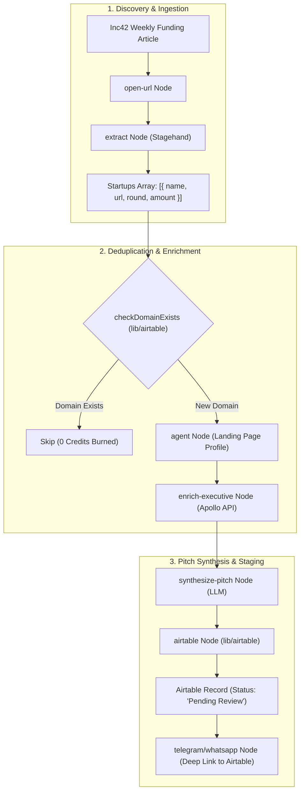

# Funded Startup Lead Generation & Outreach Engine

*   **Author:** Anurag1428
*   **Status:** Approved
*   **Date:** 2026-11-10

--------------------------------------------------------------------------------

## Overview

This feature introduces an automated workflow pipeline in Navix to discover newly funded startups from technology news sources (Inc42), profile their product domains, resolve verified technical decision-maker contact details (CTO or CEO) using B2B enrichment APIs (Apollo/Hunter), synthesize targeted peer-to-peer engineering pitches, and stage drafts into Airtable for human review before sending.

The feature is delivered incrementally across five isolated, independently verifiable phases:
1. Airtable Staging Schema & Storage Service
2. B2B Executive Enrichment Client (Apollo API)
3. Navix Executive Enrichment Workflow Node
4. Pitch Synthesis Workflow Node
5. Inc42 Extraction & End-to-End Workflow DAG

## The Problem

Software engineers, AI developers, and technical contractors seeking high-leverage roles spend 30 to 45 minutes per company manually discovering funded startups, researching executive contacts, checking whether verified corporate email addresses exist, and writing custom cold outreach messages.

Attempting to automate this blindly with zero-human-in-the-loop scripts creates critical failure modes:
1. **Domain Reputation Burn**: Unverified emails result in high bounce rates (>2-3%), triggering automated spam filtering by Google Workspace and Microsoft Outlook.
2. **Spam Flagging**: Hallucinated or robotic AI messages sent simultaneously to multiple executives at the same company trigger spam reports, permanently destroying sender credibility.
3. **API Credit Waste**: Scraping and querying enrichment APIs on every run without pre-flight deduplication rapidly exhausts paid API credit quotas on duplicate domains.

The system needs an automated discovery and drafting engine coupled with an Airtable staging gate, giving the user a 10-second review checkpoint per company before any email is dispatched.

## Goals

*   **Automated Funding Detection**: Extract startup names, company website URLs, funding amounts, and rounds from Inc42 articles using browser extraction.
*   **Company Intelligence Profiling**: Scrape landing pages to extract core technical domains and product value propositions.
*   **Single-Target Executive Resolution**: Resolve exactly one primary technical decision-maker per startup (CEO for teams <15 employees; CTO or VP of Engineering for teams >=15 employees) with a verified corporate email and LinkedIn profile via Apollo/Hunter.
*   **Credit-Efficient Deduplication**: Query the target Airtable base by domain before executing enrichment requests to prevent duplicate credit consumption.
*   **Targeted Pitch Synthesis**: Generate concise (<120 words), peer-to-peer cold outreach drafts connecting the candidate's engineering skills to the startup's funding milestones and technical architecture.
*   **Human-in-the-Loop Staging**: Stage structured leads and email drafts into an `Outbound Pitches` Airtable table with `Status = 'Pending Review'` for manual 1-click approval.
*   **Modular Phase-by-Phase Implementation**: Enforce clean repository commit boundaries across 5 isolated, testable pull requests.

## Non-Goals

*   **Zero-Approval Direct Sending**: Unvetted mass emailing is strictly banned to protect the sender domain reputation.
*   **Multi-Contact Blasting**: Sending simultaneous cold pitches to multiple executives at the same startup is out of scope.
*   **Unauthenticated Browser Scraping of LinkedIn**: Relying on brittle web scraping for private contact details is excluded in favor of compliant B2B API lookups.
*   **Multi-Stage Automated Follow-Up Sequences**: Multi-step drip campaigns (automated follow-ups) are deferred to Phase 2 to avoid complex reply-tracking state machines in Version 1.
*   **Automatic Scheduled Execution in v1**: Scheduled background execution is out of scope for the initial release; execution is on-demand/manual until pipeline stability is verified.

## Open Questions

*   **Question 1**: Should the candidate profile (skills, portfolio links, preferred roles) be passed as input fields to the `synthesize-pitch` node, or loaded from an environment/user profile configuration file?
*   **Question 2**: For startups where Apollo returns no verified corporate email, should the workflow mark the record as `Missing Contact` and stage the LinkedIn profile, or halt downstream processing for that startup entirely?

## Critical User Journeys (CUJs)

### CUJ 1: Manual Run & Batch Staging
*   **Given**: An Inc42 article URL reporting recent startup funding rounds, and an initialized Airtable base with the `Outbound Pitches` table schema.
*   **When**: The user triggers the `funded-startup-outreach` workflow manually in Navix.
*   **Then**: The system extracts funded startups, skips previously processed domains, enriches new companies with technical executive contacts, synthesizes personalized pitches, and inserts new rows into Airtable with `Status = 'Pending Review'`.

### CUJ 2: Human Review & Approval Gate
*   **Given**: Staged records exist in Airtable with `Status = 'Pending Review'`.
*   **When**: The user opens Airtable, reviews the drafted subject and body, and changes the record status to `Approved`.
*   **Then**: The record is marked ready for dispatch, ensuring zero unreviewed or hallucinated messages are sent.

--------------------------------------------------------------------------------

## Technical Plan (Architecture)

### High-Level Architecture & Subsystem Boundaries

The system architecture integrates three subsystems:
1. **The Ingestion & Browser Crawler**: Extracts unstructured funding articles from Inc42 and parses company landing pages using Navix's Stagehand/Browserbase automation engine.
2. **The Enrichment & Intelligence Core**: Communicates server-side with Apollo's B2B People Search API, applies decision-maker title prioritization, and prompts local LLMs (Groq Qwen / Gemini Flash) for grounded pitch generation.
3. **The Staging & Notification Layer**: Synchronizes enriched leads and pitch drafts with Airtable using a dedicated schema isolated from standard application tables, with optional completion notifications via Telegram/WhatsApp.



### Data Contracts & TypeScript Interfaces

#### 1. Executive Enrichment Contract (`lib/enrichment/types.ts`)
```ts
export interface ExecutiveSearchOptions {
  domain: string
  companyName?: string
  priorityTitles?: string[]
}

export interface EnrichedExecutive {
  name: string
  firstName: string
  title: string
  email: string
  emailConfidence: number // 0 to 100 percentage
  linkedinUrl?: string
  companyDomain: string
  provider: "apollo" | "hunter" | "none"
}
```

#### 2. Pitch Synthesis Contract (`features/workflows/nodes/synthesize-pitch.ts`)
```ts
export interface CandidateProfile {
  name: string
  title: string
  coreSkills: string[]
  proofPoints: string[]
  portfolioUrl?: string
}

export interface PitchSynthesisInput {
  companyName: string
  companyDomain: string
  fundingRound: string
  fundingAmount: string
  leadInvestors?: string
  productSummary: string
  executive: EnrichedExecutive
  candidate: CandidateProfile
}

export interface SynthesizedPitchOutput {
  subject: string
  body: string
  keyHook: string
  alternativeAngles: string[]
}
```

#### 3. Airtable Staging Schema (`lib/airtable/outbound-types.ts`)
```ts
export type OutboundPitchStatus = 
  | "Pending Review"
  | "Approved"
  | "Rejected"
  | "Sent"
  | "Missing Contact"

export interface OutboundPitchFields {
  "Company Name": string
  "Website / Domain": string
  "Funding Round": "Seed" | "Pre-Series A" | "Series A" | "Series B" | "Growth"
  "Funding Amount"?: string
  "Lead Investors"?: string
  "Executive Name": string
  "Executive Title": string
  "Executive Email": string
  "Executive LinkedIn"?: string
  "Email Confidence": number
  "Draft Subject": string
  "Draft Body": string
  "Alternative Angles"?: string
  "Status": OutboundPitchStatus
  "Staged Date": string
  "Navix Run ID"?: string
}
```

### Workflow Node Integration (The Navix 3-File Contract)

In compliance with the Navix workflow architecture rules, two new action nodes are introduced:

#### Node 1: `enrich-executive`
1. **Executor Impl**: `features/workflows/nodes/enrich-executive.ts`
   * Calls `lib/enrichment/apollo-client.ts` with domain and target role hierarchy.
   * If confidence is below 80% or no email is returned, returns `provider = 'none'`.
2. **Registry Entry**: Added to `features/workflows/nodes/node-registry.ts` with kind `enrichExecutive`, icon `Search`, accent `bg-indigo-500`, inputs `domain`, `companyName`, and outputs `executiveName`, `executiveTitle`, `executiveEmail`, `emailConfidence`, `linkedinUrl`.
3. **Executor Mapping**: Added to `features/workflows/nodes/node-executors.ts` satisfying `Record<ActionNodeType, NodeExecutor>`.

#### Node 2: `synthesize-pitch`
1. **Executor Impl**: `features/workflows/nodes/synthesize-pitch.ts`
   * Takes extracted company profile and enriched executive metadata.
   * Prompts the configured LLM with strict grounding constraints (word count <= 120 words, zero flattery, peer-to-peer tone).
2. **Registry Entry**: Added to `features/workflows/nodes/node-registry.ts` with kind `synthesizePitch`, icon `Sparkles`, accent `bg-violet-500`.
3. **Executor Mapping**: Added to `features/workflows/nodes/node-executors.ts`.

### Array Handling in Navix DAG Execution

Navix's default workflow runner (`features/workflows/tasks/run-workflow.ts`) operates on scalar inputs and outputs. To handle an array of 5–15 startups extracted from a single Inc42 article without requiring major engine-level graph rewrites:
* **The Batch Step Pattern**: Downstream enrichment and pitch staging are implemented as an iterated task loop within the executor or via a composite batch action (`enrich-and-stage-pitches`), iterating over the extracted startup array, checking Airtable per domain, querying Apollo, generating the pitch, and inserting each row into Airtable.
* **Failure Isolation**: An API error or low-confidence email on Startup #3 will not abort processing for Startups #4 through #10. Each item logs individual telemetry to Trigger.dev.

--------------------------------------------------------------------------------

## Alternatives Considered

### Alternative 1: Direct Headless Browser Scraping of LinkedIn
*   **Pros**: Zero third-party API subscription costs upfront.
*   **Cons**: High risk of Cloudflare bot challenges, IP bans, and personal LinkedIn account suspension. Furthermore, LinkedIn does not expose private business email addresses on public DOM profiles, requiring error-prone heuristic guessing.
*   **Reason for Rejection**: Rejected by author: Unauthenticated web scraping cannot reliably extract verified corporate emails and carries high operational fragility and account suspension risk.

### Alternative 2: Zero-Approval Direct Auto-Sending (Fully Autonomous Email Blast)
*   **Pros**: 100% hands-free execution without any manual human touchpoint.
*   **Cons**: Stale email addresses from data providers result in hard bounces (>2-3%), triggering automated domain penalties across Gmail and Outlook. Hallucinated AI pitches permanently burn executive relationships.
*   **Reason for Rejection**: Rejected by author: Preserving sender domain reputation and message quality outweighs full hands-free automation. A 10-second human review in Airtable ensures zero unvetted emails leave the outbox.

### Alternative 3: Simultaneous Multi-Executive Contact Blasting
*   **Pros**: Reaches multiple people within the target organization at once.
*   **Cons**: Startup leadership teams (<50 employees) operate in close coordination. Receiving identical or slightly varied automated cold pitches on the same morning flags the candidate as an indiscriminate spammer, guaranteeing instant rejection.
*   **Reason for Rejection**: Rejected by author: Reaching out to multiple executives simultaneously creates an adversarial impression. A single, focused outreach to the primary technical decision-maker yields significantly higher conversion.

### Alternative 4: Engine-Level DAG For-Each Iteration Primitive
*   **Pros**: Allows the visual canvas graph to explicitly represent multi-item loops.
*   **Cons**: Requires extensive refactoring of Navix's core workflow execution engine (`run-workflow.ts`), edge state persistence, and Trigger.dev step handlers, introducing high architectural risk.
*   **Reason for Rejection**: Rejected by author: Implementing an array-aware batch step action (`enrich-and-stage-pitches`) handles multi-company batches cleanly within existing Navix execution semantics without core engine modification.

--------------------------------------------------------------------------------

## Detailed Implementation Plan

The implementation is executed in five discrete, independently testable phases to ensure clean git commit history and avoid monolithic pull requests.

### Phase 1: Airtable Staging Schema & Storage Service
*   **`lib/airtable/outbound-types.ts`** (New File):
    *   *Rationale*: Defines the TypeScript schema for the `Outbound Pitches` Airtable table (`OutboundPitchFields`, `OutboundPitchStatus`, and `OutboundPitchRecord`), maintaining strict type isolation from the existing candidate job-application tracker types.
*   **`lib/airtable/outbound-service.ts`** (New File):
    *   *Rationale*: Implements the data-access functions:
        1.  `checkDomainExists(baseId: string, domain: string): Promise<boolean>`: Performs pre-flight domain lookup using a filtered formula (`FIND(LOWER(domain), LOWER({Website / Domain})) > 0`) to prevent duplicate API credit burn.
        2.  `createOutboundPitch(baseId: string, fields: OutboundPitchFields): Promise<string>`: Inserts a new pitch record with default `Status = 'Pending Review'`.
*   **`lib/airtable/__tests__/outbound-service.test.ts`** (New File):
    *   *Rationale*: Provides unit tests mocking the Airtable SDK to verify deduplication queries, field mappings, and error handling for missing base credentials.
*   **`.env.example`** (Modified File):
    *   *Rationale*: Documents required environment variables `AIRTABLE_OUTBOUND_BASE_ID` and `AIRTABLE_OUTBOUND_TABLE_NAME`.

### Phase 2: B2B Executive Enrichment Client (Apollo API)
*   **`lib/enrichment/types.ts`** (New File):
    *   *Rationale*: Defines request options (`ExecutiveSearchOptions`) and the normalized `EnrichedExecutive` contract (`name`, `firstName`, `title`, `email`, `emailConfidence`, `linkedinUrl`, `provider`).
*   **`lib/enrichment/apollo-client.ts`** (New File):
    *   *Rationale*: Implements `searchExecutiveByDomain(domain: string, options?: ExecutiveSearchOptions): Promise<EnrichedExecutive | null>`. Queries Apollo's People Search API (`https://api.apollo.io/v1/mixed-people/search`), applies title hierarchy priority (`["CTO", "VP Engineering", "Head of AI", "Founder", "CEO"]`), extracts verified email, and maps confidence scores. Returns `provider: 'none'` if no verified email exists.
*   **`lib/enrichment/__tests__/apollo-client.test.ts`** (New File):
    *   *Rationale*: Unit tests validating response parsing, title prioritization logic, and graceful handling of empty or low-confidence search results using mocked HTTP fixtures.
*   **`.env.example`** (Modified File):
    *   *Rationale*: Documents the required `APOLLO_API_KEY`.

### Phase 3: Navix Executive Enrichment Workflow Node
*   **`features/workflows/nodes/enrich-executive.ts`** (New File):
    *   *Rationale*: Implements the node executor logic adhering to the `NodeExecutor` interface. Ingests `companyDomain` and optional `priorityTitles`, calls `searchExecutiveByDomain`, and produces output parameters (`executiveName`, `executiveTitle`, `executiveEmail`, `emailConfidence`, `linkedinUrl`).
*   **`features/workflows/nodes/node-executors.ts`** (Modified File):
    *   *Rationale*: Registers `enrichExecutive` within the central `nodeExecutors` map, satisfying the compile-time `Record<ActionNodeType, NodeExecutor>` contract.
*   **`features/workflows/nodes/node-registry.ts`** (Modified File):
    *   *Rationale*: Adds the manifest entry for `enrichExecutive`: kind `enrichExecutive`, label "Enrich Executive", icon `Search`, accent `bg-indigo-500`, description, category "Integrations", inputs schema, and output variable references.
*   **`features/workflows/nodes/__tests__/enrich-executive.test.ts`** (New File):
    *   *Rationale*: Tests node execution in isolation with valid inputs, missing domain inputs, and mock enrichment responses.

### Phase 4: Pitch Synthesis Workflow Node
*   **`features/workflows/nodes/synthesize-pitch.ts`** (New File):
    *   *Rationale*: Implements the pitch synthesis node executor. Consumes `companyName`, `productSummary`, `fundingRound`, `fundingAmount`, `executiveName`, `executiveTitle`, and candidate profile context. Formulates a constrained prompt to generate a personalized cold outreach email (length < 120 words, peer-to-peer tone, zero ungrounded flattery) and returns `subject`, `body`, and `alternativeAngles`.
*   **`features/workflows/nodes/node-executors.ts`** (Modified File):
    *   *Rationale*: Registers `synthesizePitch` in the `nodeExecutors` contract map.
*   **`features/workflows/nodes/node-registry.ts`** (Modified File):
    *   *Rationale*: Adds manifest entry for `synthesizePitch`: kind `synthesizePitch`, label "Synthesize Pitch", icon `Sparkles`, accent `bg-violet-500`, inputs schema, and output variable references.
*   **`features/workflows/nodes/__tests__/synthesize-pitch.test.ts`** (New File):
    *   *Rationale*: Verifies prompt construction, schema validation of LLM outputs, and strict length limit enforcement.

### Phase 5: Inc42 Ingestion & Full End-to-End Workflow DAG
*   **`features/workflows/templates/funded-startup-outreach.json`** (New File):
    *   *Rationale*: Defines the default workflow template DAG linking:
        1.  `open-url`: Navigates to the Inc42 funding tracker or article URL.
        2.  `extract`: Extracts array of startup objects (`[{ companyName, websiteUrl, fundingAmount, round, leadInvestors }]`).
        3.  `enrich-executive`: Enriches each startup domain with technical leadership contacts.
        4.  `agent`: Profiles the startup landing page for product and tech problem context.
        5.  `synthesize-pitch`: Generates personalized outreach drafts.
        6.  `airtable`: Stages leads into the `Outbound Pitches` base with status `Pending Review`.
*   **`scripts/test-outreach-pipeline.ts`** (New File):
    *   *Rationale*: Integration test script executing a complete dry-run against a sample Inc42 article to verify the full chain from web extraction to Airtable staging without sending real emails.
