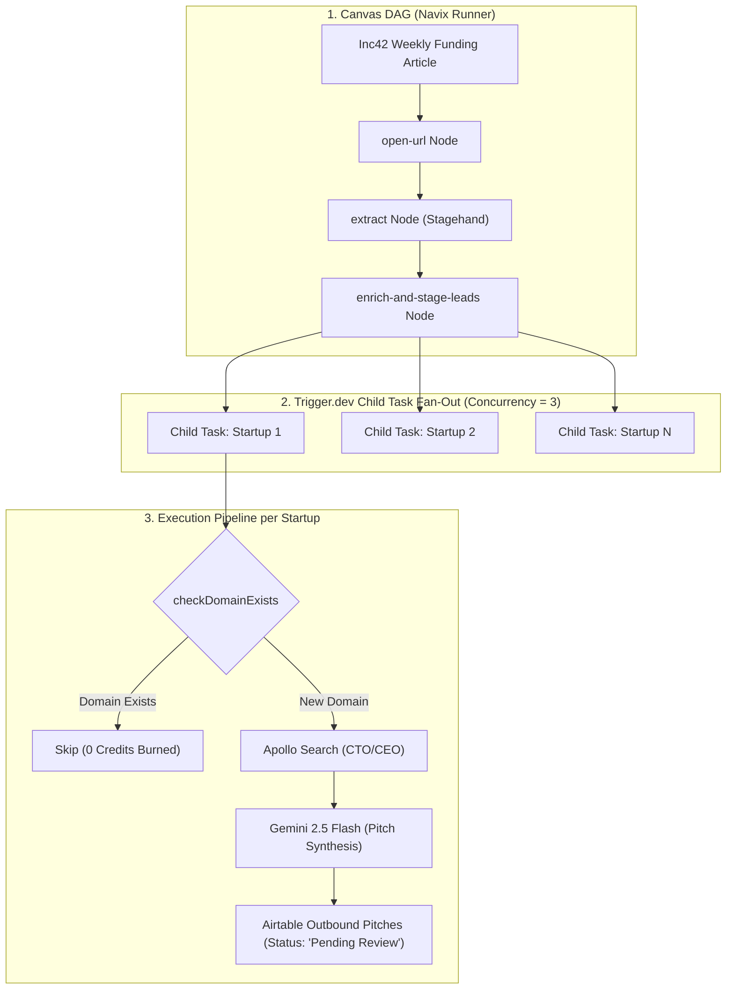

# Funded Startup Lead Generation & Outreach Engine

*   **Author:** Anurag1428
*   **Status:** Approved
*   **Date:** 2026-11-10

--------------------------------------------------------------------------------

## Overview

This feature introduces an automated workflow pipeline in Navix to discover newly funded startups from technology news sources (Inc42), profile their product domains, resolve verified technical decision-maker contact details (CTO or CEO) using B2B enrichment APIs (Apollo), synthesize targeted peer-to-peer engineering pitches, and stage drafts into Airtable for human review before sending.

The feature is delivered incrementally across five isolated, independently verifiable phases:
1. Airtable Staging Schema & Storage Service (`lib/airtable/`)
2. B2B Executive Enrichment Client (`lib/enrichment/`)
3. Pitch Synthesis Service & Candidate Profile Configuration (`lib/synthesis/`)
4. Navix Batch Outreach Action Node & Trigger.dev Child Task (`features/workflows/`)
5. Inc42 Extraction Template DAG & Integration Script

## The Problem

Software engineers, AI developers, and technical contractors seeking high-leverage roles spend 30 to 45 minutes per company manually discovering funded startups, researching executive contacts, checking whether verified corporate email addresses exist, and writing custom cold outreach messages.

Attempting to automate this blindly with zero-human-in-the-loop scripts creates critical failure modes:
1. **Domain Reputation Burn**: Unverified emails result in high bounce rates (>2-3%), triggering automated spam filtering by Google Workspace and Microsoft Outlook.
2. **Spam Flagging**: Hallucinated or robotic AI messages sent simultaneously to multiple executives at the same company trigger spam reports, permanently destroying sender credibility.
3. **API Credit Waste**: Scraping and querying enrichment APIs on every run without pre-flight deduplication rapidly exhausts paid API credit quotas on duplicate domains.

The system needs an automated discovery and drafting engine coupled with an Airtable staging gate, giving the user a 10-second review checkpoint per company before any email is dispatched.

## Goals

*   **Automated Funding Detection**: Extract startup names, company website URLs, funding amounts, and rounds from Inc42 articles using browser extraction (`open-url` + `extract`).
*   **Company Intelligence Profiling**: Fetch and extract landing page text to understand the core technical architecture and product value proposition.
*   **Single-Target Executive Resolution**: Resolve exactly one primary technical decision-maker per startup (CEO for teams <15 employees; CTO or VP of Engineering for teams >=15 employees) with a verified corporate email and LinkedIn profile via Apollo API.
*   **Credit-Efficient Deduplication**: Query the target Airtable base by domain before executing enrichment requests to prevent duplicate credit consumption.
*   **Targeted Pitch Synthesis**: Generate concise (<120 words), peer-to-peer cold outreach drafts connecting the candidate's engineering skills to the startup's funding milestones and technical architecture.
*   **Missing Contact Fallback**: When Apollo lacks a verified corporate email, stage the lead with `Status = 'Missing Contact'` and generate a 300-character LinkedIn connection note.
*   **Human-in-the-Loop Staging**: Stage structured leads and email drafts into an `Outbound Pitches` Airtable table with `Status = 'Pending Review'` for manual 1-click approval.
*   **Modular Phase-by-Phase Implementation**: Enforce clean repository commit boundaries across 5 isolated, testable pull requests.

## Non-Goals

*   **Zero-Approval Direct Sending**: Unvetted mass emailing is strictly banned to protect sender domain reputation.
*   **Multi-Contact Blasting**: Sending simultaneous cold pitches to multiple executives at the same startup is out of scope.
*   **Unauthenticated Browser Scraping of LinkedIn**: Relying on brittle web scraping for private contact details is excluded in favor of compliant B2B API lookups.
*   **Multi-Stage Automated Follow-Up Sequences**: Multi-step drip campaigns (automated follow-ups) are deferred to Phase 2 to avoid complex reply-tracking state machines in Version 1.
*   **Automatic Scheduled Execution in v1**: Scheduled background execution is out of scope for the initial release; execution is on-demand/manual until pipeline stability is verified.
*   **Modifying Navix Core DAG Runner**: Rewriting `features/workflows/tasks/run-workflow.ts` or canvas edge evaluators for loop primitives is out of scope. Downstream array processing is handled cleanly via a compound batch action node and Trigger.dev child tasks.

## Open Questions & Decisions

*   **Candidate Profile Loading**: Loaded from `config/candidate-profile.json` with fallback overrides via the `CANDIDATE_PROFILE_JSON` environment variable.
*   **Unverified Contact Handling**: Startups without a verified corporate email are staged with `Status = 'Missing Contact'`, an empty `Executive Email`, their LinkedIn profile URL, and an alternative 300-character LinkedIn note.

## Critical User Journeys (CUJs)

### CUJ 1: Manual Run & Batch Staging
*   **Given**: An Inc42 article URL reporting recent startup funding rounds, and an initialized Airtable base with the `Outbound Pitches` table schema.
*   **When**: The user triggers the `funded-startup-outreach` workflow manually in Navix.
*   **Then**: The system extracts funded startups (capped at 15 per run), skips previously processed domains, enriches new companies with technical executive contacts, synthesizes personalized pitches, and inserts new rows into Airtable with `Status = 'Pending Review'`.

### CUJ 2: Human Review & Approval Gate
*   **Given**: Staged records exist in Airtable with `Status = 'Pending Review'`.
*   **When**: The user opens Airtable, reviews the drafted subject and body, and changes the record status to `Approved`.
*   **Then**: The record is marked ready for dispatch, ensuring zero unreviewed or hallucinated messages are sent.

--------------------------------------------------------------------------------

## Technical Plan (Architecture)

### High-Level Architecture & Subsystem Boundaries

The system architecture integrates three subsystems:
1. **The Ingestion & Browser Crawler**: Extracts unstructured funding articles from Inc42 using Navix's Stagehand/Browserbase automation engine (`open-url` + `extract`).
2. **The Batch Action Node & Fan-Out Runner**: A compound action node (`enrich-and-stage-leads`) on the React Flow canvas that passes the extracted startup array to Trigger.dev child tasks (`processStartupLeadTask`) via `batchTrigger`. Each child task runs with concurrency limit = 3 to isolate errors and respect API rate limits.
3. **The Intelligence & Staging Core**: Queries Apollo People Search for verified executive contacts, fetches company landing pages with prompt-injection-fenced sanitization, invokes Gemini 2.5 Flash for grounded pitch synthesis, and writes records to Airtable `Outbound Pitches`.



### Data Contracts & TypeScript Interfaces

#### 1. Executive Enrichment Contract (`lib/enrichment/types.ts`)
```ts
export interface ExecutiveSearchOptions {
  domain: string
  companyName?: string
  priorityTitles?: string[]
}

export interface EnrichedExecutive {
  name: string
  firstName: string
  title: string
  email: string
  emailConfidence: number // 0 to 100 percentage
  linkedinUrl?: string
  companyDomain: string
  provider: "apollo" | "none"
}
```

#### 2. Pitch Synthesis Contract (`lib/synthesis/types.ts`)
```ts
export interface CandidateProfile {
  name: string
  title: string
  coreSkills: string[]
  proofPoints: string[]
  portfolioUrl?: string
}

export interface PitchSynthesisInput {
  companyName: string
  companyDomain: string
  fundingRound: string
  fundingAmount: string
  leadInvestors?: string
  productSummary: string
  executive: EnrichedExecutive
  candidate: CandidateProfile
}

export interface SynthesizedPitchOutput {
  subject: string
  body: string
  keyHook: string
  alternativeAngles: string[]
  linkedinNote?: string
}
```

#### 3. Airtable Staging Schema (`lib/airtable/outbound-types.ts`)
```ts
export type OutboundPitchStatus = 
  | "Pending Review"
  | "Approved"
  | "Rejected"
  | "Sent"
  | "Missing Contact"

export interface OutboundPitchFields {
  "Company Name": string
  "Website / Domain": string
  "Funding Round": "Seed" | "Pre-Series A" | "Series A" | "Series B" | "Growth"
  "Funding Amount"?: string
  "Lead Investors"?: string
  "Executive Name": string
  "Executive Title": string
  "Executive Email": string
  "Executive LinkedIn"?: string
  "Email Confidence": number
  "Draft Subject": string
  "Draft Body": string
  "Alternative Angles"?: string
  "LinkedIn Note"?: string
  "Status": OutboundPitchStatus
  "Staged Date": string
  "Navix Run ID"?: string
}
```

### Workflow Node Integration (The Navix 3-File Contract)

In compliance with the Navix workflow architecture rules, one new compound action node is introduced:

#### Node: `enrich-and-stage-leads`
1. **Executor Impl**: `features/workflows/nodes/enrich-and-stage-leads.ts`
   * Ingests `startupsJson` (stringified array from `extract`).
   * Parses and validates input with Zod, capping batch size at 15 startups.
   * Invokes `processStartupLeadTask.batchTrigger(tasks)` in Trigger.dev with concurrency limit = 3.
   * Returns `{ totalStartups: number, queuedCount: number }`.
2. **Registry Entry**: Added to `features/workflows/nodes/node-registry.ts` with kind `action`, type `enrichAndStageLeads`, icon `Sparkles`, accent `bg-indigo-500`, description "Enriches extracted startups with executive contacts, generates pitches, and stages to Airtable", category "Integrations".
3. **Executor Mapping**: Added to `features/workflows/nodes/node-executors.ts` satisfying `Record<ActionNodeType, NodeExecutor>`.

--------------------------------------------------------------------------------

## Risks & Mitigations

| Risk | Impact | Architectural Mitigation |
| :--- | :--- | :--- |
| **Airtable 5 QPS Rate Limit** | 429 Too Many Requests errors causing failed row insertions | Child task queue concurrency is clamped to `concurrencyLimit: 3`. The Airtable client implements exponential backoff retry up to 3 attempts. |
| **Apollo API Credit Exhaustion** | Unnecessary spend querying duplicate companies | Pre-flight deduplication via `checkDomainExists(baseId, domain)` runs before calling Apollo. If a domain already exists in Airtable, Apollo is never queried. |
| **Indirect Prompt Injection from Scraped Web Content** | Malicious content on startup landing pages manipulating pitch synthesis | Scraped third-party page text is strictly fenced within `<company_context>...</company_context>` XML tags and clamped to 2,000 characters before LLM prompting. |
| **Downstream Array vs Scalar DAG Runner Mismatch** | Canvas engine fails or requires core architecture rewrite | Handled via compound action node on canvas and Trigger.dev `batchTrigger` child tasks. Canvas engine requires zero modifications. |
| **Missing Verified Email** | Outreach blocked or bounce rate spike | Fallback logic: marks status as `Missing Contact` and generates a 300-character LinkedIn connection note instead of halting. |

--------------------------------------------------------------------------------

## Alternatives Considered

### Alternative 1: Direct Headless Browser Scraping of LinkedIn
*   **Pros**: Zero third-party API subscription costs upfront.
*   **Cons**: High risk of Cloudflare bot challenges, IP bans, and personal LinkedIn account suspension. Furthermore, LinkedIn does not expose private business email addresses on public DOM profiles, requiring error-prone heuristic guessing.
*   **Reason for Rejection**: Unauthenticated web scraping cannot reliably extract verified corporate emails and carries high operational fragility and account suspension risk.

### Alternative 2: Zero-Approval Direct Auto-Sending (Fully Autonomous Email Blast)
*   **Pros**: 100% hands-free execution without any manual human touchpoint.
*   **Cons**: Stale email addresses from data providers result in hard bounces (>2-3%), triggering automated domain penalties across Gmail and Outlook. Hallucinated AI pitches permanently burn executive relationships.
*   **Reason for Rejection**: Preserving sender domain reputation and message quality outweighs full hands-free automation. A 10-second human review in Airtable ensures zero unvetted emails leave the outbox.

### Alternative 3: Simultaneous Multi-Executive Contact Blasting
*   **Pros**: Reaches multiple people within the target organization at once.
*   **Cons**: Startup leadership teams (<50 employees) operate in close coordination. Receiving identical or slightly varied automated cold pitches on the same morning flags the candidate as an indiscriminate spammer, guaranteeing instant rejection.
*   **Reason for Rejection**: Reaching out to multiple executives simultaneously creates an adversarial impression. A single, focused outreach to the primary technical decision-maker yields significantly higher conversion.

### Alternative 4: Engine-Level DAG For-Each Iteration Primitive
*   **Pros**: Allows the visual canvas graph to explicitly represent multi-item loops.
*   **Cons**: Requires extensive refactoring of Navix's core workflow execution engine (`run-workflow.ts`), edge state persistence, and Trigger.dev step handlers, introducing high architectural risk.
*   **Reason for Rejection**: Implementing an array-aware batch step action (`enrich-and-stage-leads`) handles multi-company batches cleanly within existing Navix execution semantics without core engine modification.

--------------------------------------------------------------------------------

## Detailed Implementation Plan

The implementation is executed in five discrete, independently testable phases to ensure clean git commit history and avoid monolithic pull requests.

### Phase 1: Airtable Staging Schema & Storage Service
*   **`lib/airtable/outbound-types.ts`** (New File):
    *   *Rationale*: Defines the TypeScript schema for the `Outbound Pitches` Airtable table (`OutboundPitchFields`, `OutboundPitchStatus`, and `OutboundPitchRecord`), maintaining strict type isolation from the existing candidate job-application tracker types.
*   **`lib/airtable/outbound-service.ts`** (New File):
    *   *Rationale*: Implements the data-access functions:
        1.  `checkDomainExists(baseId: string, domain: string): Promise<boolean>`: Performs pre-flight domain lookup using a filtered formula (`FIND(LOWER(domain), LOWER({Website / Domain})) > 0`) to prevent duplicate API credit burn.
        2.  `createOutboundPitch(baseId: string, fields: OutboundPitchFields): Promise<string>`: Inserts a new pitch record with default `Status = 'Pending Review'`.
*   **`lib/airtable/__tests__/outbound-service.test.ts`** (New File):
    *   *Rationale*: Provides unit tests mocking the Airtable SDK to verify deduplication queries, field mappings, and error handling for missing base credentials.
*   **`.env.example`** (Modified File):
    *   *Rationale*: Documents required environment variables `AIRTABLE_OUTBOUND_BASE_ID` and `AIRTABLE_OUTBOUND_TABLE_NAME`.

### Phase 2: B2B Executive Enrichment Client (Apollo API)
*   **`lib/enrichment/types.ts`** (New File):
    *   *Rationale*: Defines request options (`ExecutiveSearchOptions`) and the normalized `EnrichedExecutive` contract (`name`, `firstName`, `title`, `email`, `emailConfidence`, `linkedinUrl`, `provider`).
*   **`lib/enrichment/apollo-client.ts`** (New File):
    *   *Rationale*: Implements `searchExecutiveByDomain(domain: string, options?: ExecutiveSearchOptions): Promise<EnrichedExecutive | null>`. Queries Apollo's People Search API (`https://api.apollo.io/v1/mixed-people/search`), applies title hierarchy priority (`["CTO", "VP Engineering", "Head of AI", "Founder", "CEO"]`), extracts verified email, and maps confidence scores. Returns `provider: 'none'` if no verified email exists.
*   **`lib/enrichment/__tests__/apollo-client.test.ts`** (New File):
    *   *Rationale*: Unit tests validating response parsing, title prioritization logic, and graceful handling of empty or low-confidence search results using mocked HTTP fixtures.
*   **`.env.example`** (Modified File):
    *   *Rationale*: Documents the required `APOLLO_API_KEY`.

### Phase 3: Pitch Synthesis Service & Candidate Profile Configuration
*   **`lib/synthesis/types.ts`** (New File):
    *   *Rationale*: Defines `CandidateProfile`, `PitchSynthesisInput`, and `SynthesizedPitchOutput` interfaces.
*   **`config/candidate-profile.json`** (New File):
    *   *Rationale*: Default candidate profile configuration file defining engineering background, key technical strengths, and portfolio references.
*   **`lib/synthesis/pitch-synthesizer.ts`** (New File):
    *   *Rationale*: Implements pitch synthesis using Gemini Flash (`@google/genai`). Ingests company context and candidate profile, enforces `<company_context>` prompt fencing, word limit (<120 words), peer-to-peer tone, and produces structured outputs with Zod validation. Handles LinkedIn connection note fallback when email is absent.
*   **`lib/synthesis/__tests__/pitch-synthesizer.test.ts`** (New File):
    *   *Rationale*: Unit tests validating prompt fencing, JSON parsing, word count compliance, and fallback generation.

### Phase 4: Navix Batch Outreach Action Node & Trigger.dev Child Task
*   **`features/workflows/tasks/process-startup-lead.ts`** (New File):
    *   *Rationale*: Implements the Trigger.dev background task (`processStartupLeadTask`) processing a single startup: checks Airtable deduplication, queries Apollo, extracts landing page text, generates pitch, and stages to Airtable. Configured with `concurrencyLimit: 3`.
*   **`features/workflows/nodes/enrich-and-stage-leads.ts`** (New File):
    *   *Rationale*: Implements the node executor logic adhering to the `NodeExecutor` interface. Ingests `startupsJson`, validates input, and fans out child tasks via `processStartupLeadTask.batchTrigger()`.
*   **`features/workflows/nodes/node-executors.ts`** (Modified File):
    *   *Rationale*: Registers `enrichAndStageLeads` within the central `nodeExecutors` map satisfying `Record<ActionNodeType, NodeExecutor>`.
*   **`features/workflows/nodes/node-registry.ts`** (Modified File):
    *   *Rationale*: Adds manifest entry for `enrichAndStageLeads`: kind `action`, type `enrichAndStageLeads`, icon `Sparkles`, accent `bg-indigo-500`, inputs schema, and outputs summary.
*   **`features/workflows/nodes/__tests__/enrich-and-stage-leads.test.ts`** (New File):
    *   *Rationale*: Unit tests validating input schema parsing, batch cap enforcement (max 15), and Trigger.dev dispatch mocking.

### Phase 5: Inc42 Ingestion Template DAG & Integration Script
*   **`features/workflows/templates/funded-startup-outreach.json`** (New File):
    *   *Rationale*: Defines the default workflow template DAG:
        1.  `open-url`: Navigates to the Inc42 funding tracker or article URL.
        2.  `extract`: Extracts array of startup objects (`[{ companyName, websiteUrl, fundingAmount, round, leadInvestors }]`).
        3.  `enrich-and-stage-leads`: Fans out enrichment, pitch generation, and Airtable staging.
*   **`scripts/test-outreach-pipeline.ts`** (New File):
    *   *Rationale*: Integration test script executing a complete dry-run against a sample Inc42 article to verify the full chain without sending real emails.
